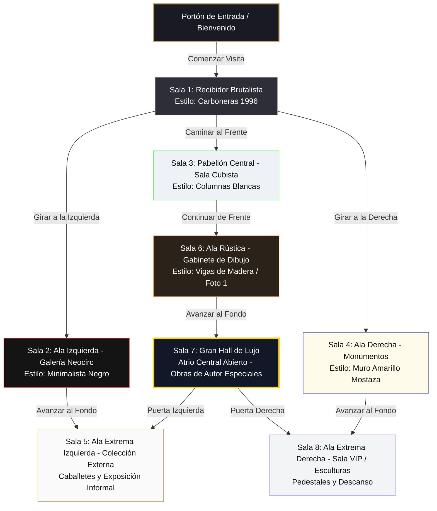

# Plano Arquitectónico y Distribución: Galería Virtual 3D "Universo EDUSSE"

Este documento define la estructura física, la distribución de salas (estancias) y el flujo de navegación del visitante dentro del "edificio" de la galería virtual.

---

## 🗺️ Mapa de Planta (Floor Plan)

El museo se organiza con un gran eje monumental en el centro que culmina en un atrio abierto de doble altura (Gran Hall de Lujo), con las salas de exposiciones externas expandiéndose hacia las alas laterales extremas (izquierda y derecha).

---

## 🏢 Fichas Estéticas y Técnicas de las Estancias (Estilo Galería de París)

### 1. Vestíbulo Central (Sala 1 - Inicio)
* **Estilo**: **Galería Brutalista Carboneras 1996** (Inspirado en tu obra de 1996).
* **Techo**: Techo de hormigón visto con textura de encofrado de tablones de madera.
* **Paredes**: Paneles exentos y divisores en color gris medio/cemento claro, colocados de forma que dividen el flujo de circulación y sirven de soporte a las obras.
* **Suelo**: Hormigón pulido gris claro con un brillo suave que refleja los cuadros.
* **Iluminación**: Luz cenital/indirecta que entra desde los laterales superiores del techo, complementada con focos lineales de realce.
* **Colección**: `00 EDUSSE` (Obras místicas fundamentales).
* **Distribución**: Los cuadros se cuelgan directamente sobre los paneles exentos flotantes.

### 2. La Gran Rotonda (Sala 2 - Izquierda)
* **Estilo**: **Gran Galería Circular / Rotonda Clásica** (Inspirado en la sala curva del primer plano).
* **Estructura**: Una majestuosa sala circular con paredes curvas. En el centro de la rotonda se colocan pedestales para esculturas o displays exentos.
* **Paredes**: Paredes oscuras de galería curvadas que abrazan al visitante.
* **Suelo**: Parquet dispuesto en círculos concéntricos o cemento pulido liso.
* **Iluminación**: Iluminación indirecta perimetral que resalta la curva y focos orientados hacia las obras de la pared curva.
* **Colección**: `01 EXP NEOCIRC` (Vórtices y cielos en espiral, que encajan de forma perfecta con la geometría circular de la sala).

### 3. Pabellón Central (Sala 3 - Frente)
* **Estilo**: **Gran Galería de Columnas** (Inspirado en la Foto 3).
* **Estructura**: Columnas blancas esbeltas de soporte que dividen visualmente la estancia.
* **Paredes**: Blanco galería puro para dar máxima amplitud.
* **Suelo**: Madera de roble claro dispuesta en tablones largos.
* **Iluminación**: Panel translúcido central en el techo (claraboya simulada) combinado con focos en rieles.
* **Colección**: `02 CUBESSE STILO` (Cubismo geométrico).

### 4. Ala Monumentos (Sala 4 - Derecha)
* **Estilo**: **Espacio Expositivo de Contraste** (Inspirado en la Foto 4).
* **Paredes**: Paredes con colores de acento potentes (un gran muro de color amarillo mostaza vibrante, y otros en gris industrial).
* **Suelo**: Hormigón pulido de alto brillo con reflejos de las obras.
* **Iluminación**: Rieles de iluminación moderna suspendidos.
* **Colección**: `03 EXPNEOPLUS` (Monumentos del mundo).
* **Distribución**: Paneles gigantescos que albergan obras de gran formato en solitario.

### 5. Ala Extrema Izquierda - Colección Externa (Sala 5)
* **Estilo**: **Taller de Exposición Alternativa** (Inspirado en la Foto 5, desplazado hacia el lateral extremo izquierdo).
* **Paredes**: Blanco roto cálido.
* **Distribución Especial**: Cuadros descansando sobre caballetes de mesa, paneles bajos o apoyados en el suelo contra la pared.
* **Colección**: `48 BESSELUXY L` / Obras especiales de colaboradores.

### 6. Ala Rústica - Gabinete de Dibujo (Sala 6 - Frente Profundo)
* **Estilo**: **Galería Francesa Rústica-Moderna** (Inspirado en la Foto 1).
* **Techo**: Techo de vigas de madera rústica expuestas y vistas.
* **Paredes**: Paredes blancas puras con textura de yeso.
* **Suelo**: Suelo de microcemento pulido o losa de piedra clara.
* **Iluminación**: Proyectores y focos blancos de luz cálida anclados sobre rieles negros entre las vigas.
* **Colección**: `05 PLUMINK` / `36 LINEART` (Dibujos a tinta fina y bocetos artísticos).
* **Distribución**: Cuadros colgados en grupos asimétricos con marcos delgados de metal o madera clara.

### 7. Gran Hall de Lujo - Atrio Central (Sala 7 - Centro Superior)
* **Estilo**: **Atrio Abierto de Honor / Lucernario Monumental** (Inspirado en tu anotación de Hall Central Abierto).
* **Estructura**: Un espacio central de gran altura coronado por una espectacular cúpula de cristal o lucernario cenital. Puede incorporar plantas ornamentales y esculturas en el centro.
* **Suelo**: Losas de piedra gris oscuro mate de gran formato.
* **Paredes**: Paneles gigantes exentos suspendidos que estructuran la sala.
* **Colección**: **Obras de Lujo Exclusivas** (Piezas de autor premium no disponibles en el catálogo regular de la tienda).
* **Distribución**: Exhibición selecta, muy espaciada y solemne.

### 8. Ala Extrema Derecha - Sala VIP / Esculturas (Sala 8)
* **Estilo**: **Espacio Lounge VIP de Exhibición** (Desplazado hacia el lateral extremo derecho).
* **Estructura**: Zona de descanso con mobiliario de diseño minimalista francés y pedestales exentos.
* **Paredes**: Revestimiento de paneles de madera clara y cemento visto.
* **Suelo**: Parquet de roble natural.
* **Colección**: Obras escultóricas y colecciones limitadas.

---

## 🧭 Mecánica de Movimiento y UI (User Interface)

1. **El Plano en Pantalla (Minimapa)**:
   * En la esquina inferior izquierda de la pantalla, el usuario tendrá un pequeño **plano interactivo** (como en la foto del Museo del Prado).
   * Un punto dorado indicará dónde se encuentra el visitante en el plano y hacia dónde está mirando.
   * Se puede hacer clic en cualquier sala del minimapa para teletransportarse directamente allí.

2. **Indicadores de Transición**:
   * Cuando el usuario se acerque a una puerta o conexión entre salas, aparecerá una **flecha brillante en 3D en el suelo** o un letrero flotante (ej. `"🚪 Entrar al Ala Neocirc"`).
   * Al hacer clic, la pantalla hará un fundido suave (fade-out/fade-in) con un movimiento de cámara que simula cruzar la puerta física.
